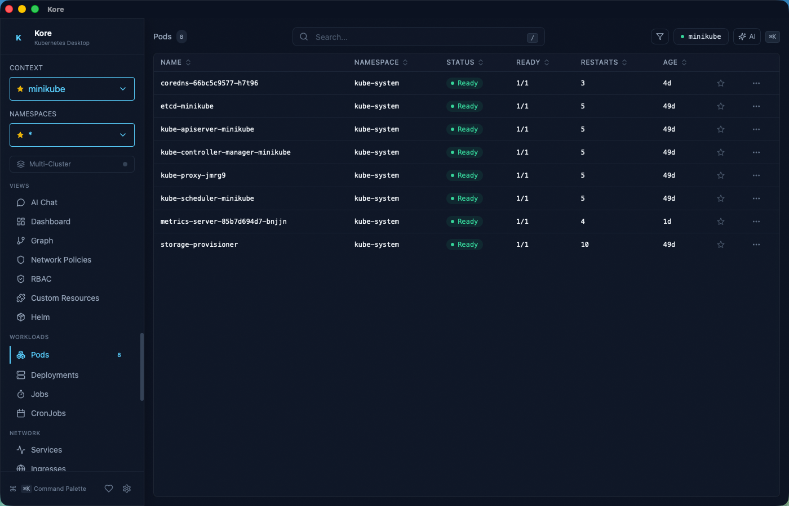
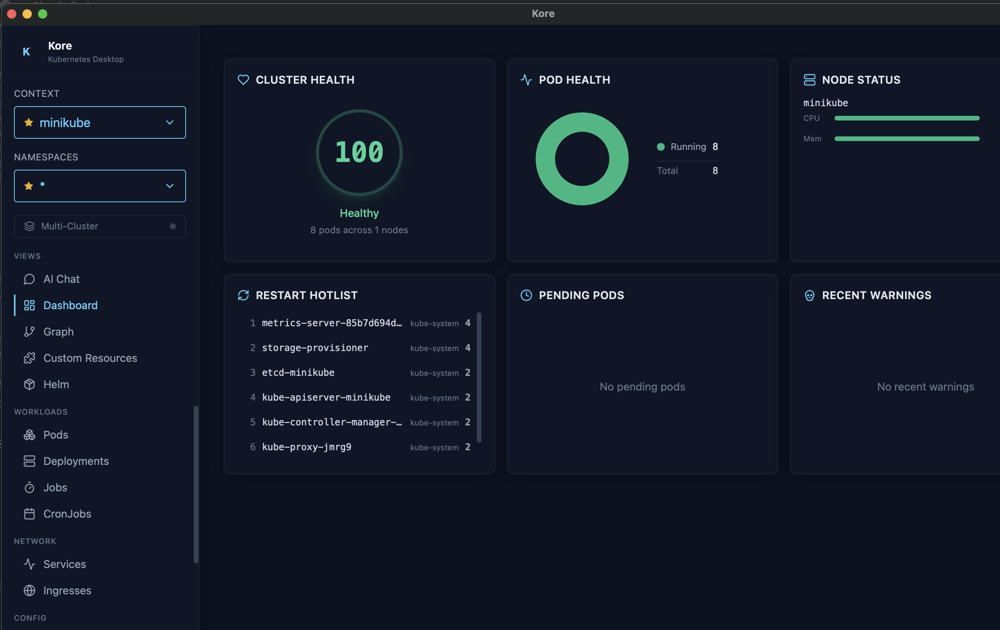
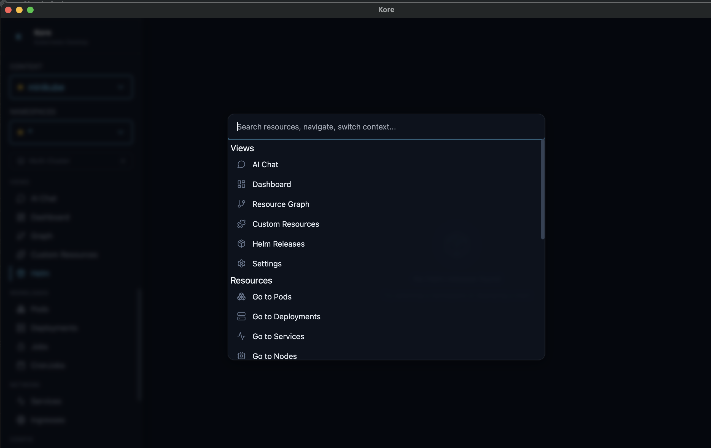
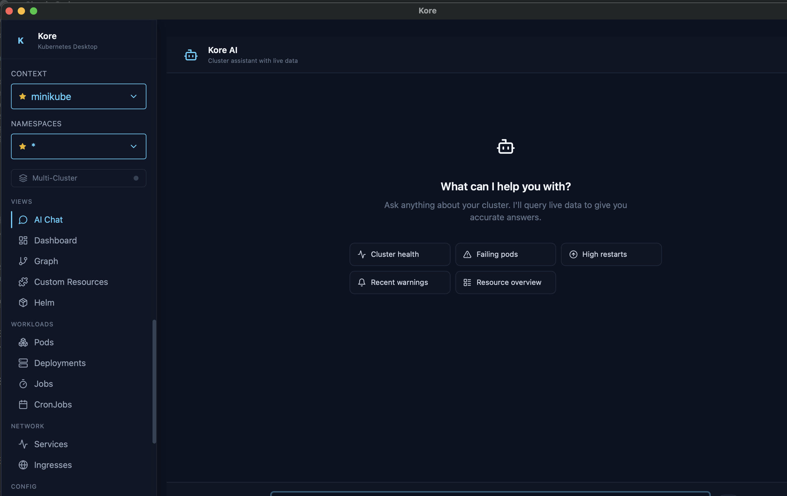

<p align="center">
  
</p>

<h1 align="center">Kore</h1>

<p align="center">
  A fast, terminal-inspired Kubernetes IDE — a native Rust app for macOS, Linux and Windows, built with GPUI.
</p>

---

## What is Kore?

Kore is a native desktop app that brings a **k9s-style**, keyboard-driven experience to Kubernetes cluster management — without living in the terminal. It is a single Rust binary: a **backend library** (`kore-core`, powered by [kube-rs](https://github.com/kube-rs/kube)) and a **GPU-rendered native UI** (`kore-app`, built on [GPUI](https://www.gpui.rs/)). No webview, no JavaScript.

If you spend your day switching between `kubectl`, `k9s`, Lens, and your browser to manage clusters, Kore consolidates that workflow into a single, fast, keyboard-first app.

## Why Kore?

- **Native performance** — one Rust process, GPU-rendered UI, direct Kubernetes API access. No Electron, no webview.
- **Real-time** — Resources are streamed via Kubernetes watch API; changes appear instantly.
- **Keyboard-driven** — Navigate entirely with keyboard shortcuts, vim-style bindings, and a command palette (`Cmd+K` / `Ctrl+K`).
- **Multi-cluster** — View and compare resources across multiple contexts side-by-side.
- **AI-assisted troubleshooting** — Diagnose issues with built-in AI support (OpenAI, Anthropic, or Ollama).

## Install

**macOS 14+** (Apple Silicon or Intel):

```bash
curl -fsSL https://raw.githubusercontent.com/koreide/Kore/main/install.sh | bash
```

Kore is not notarized. The script clears the quarantine flag for you; if you install a DMG from the release page by hand, run `xattr -dr com.apple.quarantine /Applications/kore.app` once before opening it.

**Windows 10+:** run `kore_<version>_x64-setup.exe` from the [latest release](https://github.com/koreide/Kore/releases/latest) (per-user install, no admin needed), or use the portable zip.

**Linux (x86_64):** download `kore_<version>_x86_64.tar.gz` from the [latest release](https://github.com/koreide/Kore/releases/latest), extract it and run `./install.sh` (installs to `~/.local`; set `PREFIX` to change).

## Screenshots

<p align="center">
  
</p>
<p align="center"><em>Resource table with live status updates, sortable columns, and keyboard navigation</em></p>

<p align="center">
  
</p>
<p align="center"><em>Cluster dashboard with health score, pod status ring chart, node resource bars, and restart hotlist</em></p>

<p align="center">
  
</p>
<p align="center"><em>Command palette (<code>Cmd+K</code>) for instant access to views, resources, and actions</em></p>

<p align="center">
  
</p>
<p align="center"><em>AI-assisted troubleshooting with cluster-aware suggestions and live data queries</em></p>

## Features

| Category | Details |
|---|---|
| **Resource Management** | Browse, describe, edit YAML, and delete across 10 resource types: Pods, Deployments, Services, Nodes, Events, ConfigMaps, Secrets, Ingresses, Jobs, CronJobs |
| **Real-time Watches** | Live-streaming resource updates via Kubernetes watch API |
| **Pod Operations** | Logs (single & multi-pod), exec shell (native terminal), metrics (CPU/memory charts), port forwarding |
| **Deployments** | Revision history, image diffs, one-click rollback |
| **YAML Editor** | View, edit, and apply YAML with side-by-side diff preview |
| **CRD Browser** | Discover and browse Custom Resource Definitions dynamically |
| **Dependency Graph** | Interactive SVG graph of resource relationships (ownerReferences + label selectors) |
| **Helm** | List releases, inspect values/manifests/history, rollback |
| **Cluster Dashboard** | Health score (0–100), pod status ring chart, node resource bars, restart hotlist |
| **Event History** | Live events with persistent SQLite history and time-range filtering |
| **Multi-Cluster** | Compare resources across contexts in a unified view |
| **AI Troubleshooting** | Streaming AI chat panel — supports OpenAI, Anthropic, and Ollama |
| **RBAC Simulator** | Permission matrix, role browser, reverse lookup, forbidden error analysis, natural language queries, and identity impersonation |
| **Command Palette** | `Cmd+K` for resource search, view switching, quick filters, and actions |
| **Label Filtering** | Filter resources by label selectors |
| **Pinned Resources** | Bookmark frequently accessed resources in the sidebar |
| **Settings** | Accent color, event retention, keyboard shortcut customization |

## Keyboard Shortcuts

| Shortcut | Action |
|---|---|
| `Cmd+K` (`Ctrl+K` on Linux/Windows) | Open command palette |
| `/` | Focus search |
| `j` / `k` | Navigate rows up/down |
| `l` | Enter detail view |
| `h` | Go back |
| `1`–`6` | Switch tabs in detail views |
| `?` | Show shortcut overlay |
| `Cmd+R` | Refresh resources |
| `Cmd+F` | Search logs / describe / YAML |
| `Cmd+Shift+R` | Open RBAC Simulator |

## Prerequisites

- **Rust** stable toolchain + `cargo`
- A valid `~/.kube/config` with at least one reachable context
- *(Optional)* `helm` in `PATH` for Helm features
- *(Optional)* `kubectl` in `PATH` for port forwarding and exec
- **macOS 14+**: Xcode Command Line Tools (`xcode-select --install`)
- **Linux**: X11/Wayland, Vulkan, fontconfig and xkbcommon development packages (see `crates/kore-app/packaging/linux/deps.sh`)
- **Windows**: MSVC toolchain. Release builds must be made on Windows, because GPUI precompiles its HLSL shaders with `fxc.exe`.

## Getting Started

The fastest way to get Kore is the one-liner in the [Install](#install) section above. To develop locally:

```bash
git clone https://github.com/eladbash/kore.git
cd kore
cargo run -p kore-app
```

The app will open a native window connected to your active kubeconfig context.

## Commands

| Command | Description |
|---|---|
| `cargo run -p kore-app` | Run the app (debug) |
| `cargo build --release -p kore-app` | Release binary `target/release/kore` |
| `crates/kore-app/packaging/macos/bundle.sh` | Build `kore.app` (bundle id `dev.kore.desktop`; `TARGET=<triple>` for a cross build) |
| `crates/kore-app/packaging/macos/dmg.sh <app> <out.dmg>` | Package `kore.app` into a DMG |
| `crates/kore-app/packaging/linux/install.sh` | Install binary, `.desktop` entry and icons on Linux |
| `crates/kore-app/packaging/linux/package.sh <bin> <dir>` | Linux release tarball |
| `cargo test -p kore-core -p kore-app` | Unit tests |
| `KORE_KIND=1 cargo test -p kore-core -- --include-ignored --test-threads=1` | Backend tests against the kind test clusters |
| `cargo clippy -p kore-app -p kore-core -- -D warnings` | Lints |

### End-to-end harness

`crates/kore-harness` drives the real app the way a user does: it captures the window, reads it with OCR, and sends clicks and keystrokes. It runs scenario files in `harness/scenarios/` against two local kind clusters. See [`harness/README.md`](harness/README.md).

```bash
cargo build -p kore-harness
./target/debug/kore-harness cluster up && ./target/debug/kore-harness cluster seed
cargo build --release -p kore-app
./target/debug/kore-harness run               # all scenarios against target/release/kore
./target/debug/kore-harness run -f details    # filtered
```

## Architecture

```
┌──────────────────────── kore (one process) ────────────────────────┐
│                                                                     │
│  kore-app (GPUI)  ── async calls / Subscription<T> ──►  kore-core   │
│  views, keymap, theme                                   kube-rs,    │
│  control server (test builds only)                      tokio, SQLite│
└─────────────────────────────────────────────────────────────────────┘
```

- **`crates/kore-core`** — Kubernetes and backend logic with no UI dependency: resources and watches, logs, exec, metrics, port forwarding, YAML apply/diff, rollback, dashboard, SQLite event history, CRDs, dependency graph, Helm, RBAC, network policies, multi-cluster, and AI providers. `Core` owns its tokio runtime; streams are `Subscription<T>` values that cancel on drop.
- **`crates/kore-app`** — the GPUI application (binary `kore`): routing, sidebar, resource table, details views, terminal (alacritty_terminal), charts, command palette, settings and AI chat.
- **`crates/kore-automation`** — the protocol of the Layer 2 control server, which exists only in `--features test-harness` builds. The harness uses it to drive the app and read UI state.
- **`crates/kore-testkit`** — test doubles: an in-memory Kubernetes API, sandboxed environments and fixtures, for the headless UI tests.
- **`crates/kore-harness`** — end-to-end test driver (Layers 2 and 3; see `CLAUDE.md` "Testing layers").

## Project Structure

```
kore/
├── crates/
│   ├── kore-core/        # Backend library (kube-rs)
│   ├── kore-app/         # Native GPUI app (binary `kore`)
│   │   ├── src/views/    # Feature views
│   │   ├── src/ui/       # Shared widgets (inputs, dropdowns, mono text, markdown…)
│   │   ├── assets/       # Lucide icons, app icons
│   │   └── packaging/    # macOS bundle + DMG, Linux tarball + .desktop, Windows resources + NSIS installer
│   ├── kore-automation/  # Automation protocol types
│   └── kore-harness/     # End-to-end harness
├── harness/              # Scenarios, kind cluster fixtures
└── docs/gpui-port/       # UI conventions and behavior specs
```

## Tech Stack

- [GPUI](https://www.gpui.rs/) + gpui-component — GPU-accelerated native UI
- [kube-rs](https://github.com/kube-rs/kube) + k8s-openapi — Kubernetes API client
- tokio — Async runtime
- alacritty_terminal — Terminal emulation for pod exec
- rusqlite — SQLite for persistent event history
- reqwest — HTTP client for AI providers
- similar — Diff algorithm for YAML comparison
- Lucide — Icons

## Contributing

Contributions are welcome! Here's how to get started:

1. **Fork** the repository
2. **Create a branch** for your feature or fix: `git checkout -b feat/my-feature`
3. **Make your changes** and ensure they pass checks:
   ```bash
   cargo clippy -p kore-app -p kore-core -- -D warnings
   cargo test -p kore-core -p kore-app
   ./target/debug/kore-harness run -f <area>
   ```
4. **Commit** with a clear message describing the change
5. **Open a Pull Request** against `main`

### Guidelines

- Follow existing code patterns and directory structure
- UI conventions (view contract, keyboard, theme, automation ids) are in `docs/gpui-port/CONVENTIONS.md`
- Backend logic belongs in `crates/kore-core`; keep it free of UI dependencies
- Keep PRs focused — one feature or fix per PR
- Add unit tests for new logic, and a harness scenario for new UI behavior

### Releasing

1. Bump `version` in `crates/kore-app/Cargo.toml` (both the `[package]` and `[package.metadata.bundle]` entries).
2. Tag and push: `git tag vX.Y.Z && git push origin vX.Y.Z`.
3. Add the version's entry to `CHANGELOG.md` (the release notes link to it).
4. `.github/workflows/release.yml` publishes the GitHub release for the tag. Each platform attaches its files as soon as it is built: the macOS DMGs (Apple Silicon and Intel), the Linux tarball and the Windows installer + portable zip. `SHA256SUMS.txt` is attached last.

Builds are not code signed or notarized. The macOS app is ad-hoc signed, and `install.sh` and the in-app updater clear the quarantine flag; a DMG installed by hand needs `xattr -dr com.apple.quarantine /Applications/kore.app` once. Run the workflow manually (Actions → Release → Run workflow) to build all artifacts without creating a release.

## License

MIT
